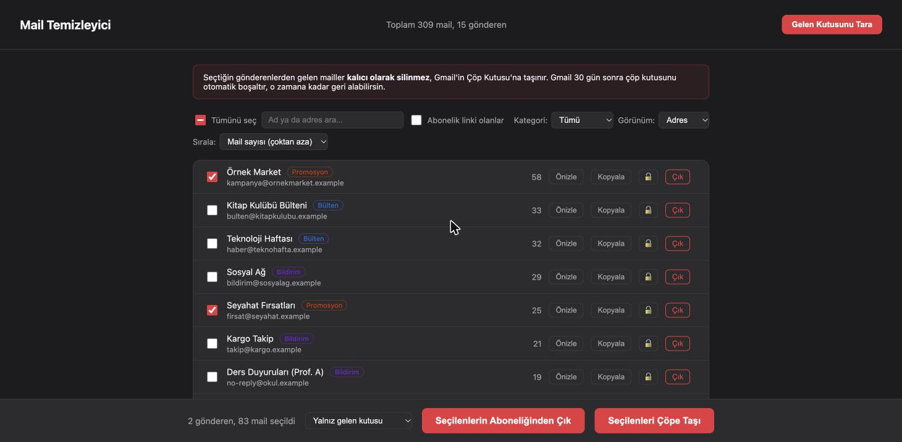

# Mail Sender Extractor

*Diğer diller: [🇹🇷 Türkçe](README.tr.md)*

A local web app that scans your Gmail inbox, groups messages by sender, and lets you bulk-trash
or unsubscribe from the senders you pick, with an undo for the last delete. It runs only on
your own machine (`localhost`); nothing is sent anywhere except Gmail's own API.



## Features

- **Fast scan with progress:** message metadata is fetched with Gmail batch requests (50 per
  batch, retried on rate limits) in the background, with a progress bar in the page.
- **One row per sender:** messages are grouped by the actual address; the same address with
  different display names is one row. Switch to a **domain view** to see `shop.com` as a whole.
- **Categories without a model:** each sender is tagged *newsletter / promotion / notification /
  personal* from Gmail's own tabs (`CATEGORY_*` labels) and the `List-Unsubscribe` header.
- **Search and filters:** search by name or address, filter by category or "has an unsubscribe
  link". "Select all" only selects the rows you can see.
- **Protected senders:** lock an address or a whole domain (`@bank.com`, subdomains included).
  Locked senders can't be selected, and the server refuses to trash or unsubscribe them.
- **Delete with the real count:** choose *inbox only* or *all mail (including archive)*; the
  confirm dialog shows how many messages will actually move to Trash.
- **Undo:** the last delete can be undone. Messages come back with their original inbox/unread
  state, so archived mail doesn't land in the inbox.
- **Unsubscribe with confirmation:** one-click unsubscribe (RFC 8058) is only sent after you
  confirm the list of senders; otherwise you get a link or `mailto:` address to open yourself.
- **Preview and copy:** see a sender's latest subjects before deleting; copy an address.

## Try it without a Gmail account (demo mode)

```bash
python3 -m venv venv
source venv/bin/activate
pip install -r requirements.txt
DEMO=1 python app.py
```

Open `http://localhost:5050`. Demo mode uses an in-memory mailbox of about 360 fake messages;
data files go to a temporary folder and unsubscribe requests never leave your machine.

## Use it with your Gmail

### 1. Google Cloud credentials (`credentials.json`)

1. Create (or select) a project in the [Google Cloud Console](https://console.cloud.google.com/).
2. Under **APIs & Services > Library**, enable the **Gmail API**.
3. Under **APIs & Services > Credentials**, choose **Create Credentials > OAuth client ID**,
   application type **Desktop app**.
4. Download the client JSON and save it in this folder as `credentials.json`.

### 2. Run

```bash
source venv/bin/activate
python app.py
```

Open `http://localhost:5050` and click **Scan Inbox**. The first time, a browser window asks you
to sign in; after that a `token.json` file keeps you signed in.

Deleted messages go to Gmail's **Trash**, not straight to permanent deletion. Gmail empties the
Trash after 30 days.

### CSV only (CLI)

```bash
python extract_senders.py
```

Writes `gonderenler.csv` with one row per address: address, display name, count, category and
whether an unsubscribe link was seen. Older CSV files (raw `From` header + count) are still read
and merged by address.

## How it works

```
browser (templates/index.html)
   │  fetch, same-origin only
   ▼
Flask app.py ── Host / Origin checks ── Gmail API (google-api-python-client)
   │                                     ├─ messages.list  (from:"addr" in:inbox)
   │                                     ├─ batch messages.get (metadata)
   │                                     ├─ messages.batchModify (TRASH)
   │                                     └─ batch messages.untrash (undo)
   └─ local files: gonderenler.csv · korunanlar.json · son_islem.json
```

| File | What it holds |
|---|---|
| `app.py` | Web server and API: scan, count, delete, undo, preview, unsubscribe, protected list |
| `extract_senders.py` | Scan logic (batched fetch, grouping, categories) and CSV read/write; also a CLI |
| `gmail_auth.py` | OAuth sign-in; `token.json` is written with `0600` permissions |
| `demo.py` | Fake mailbox for demo mode |

## Security notes

The app holds a token that can modify your mail, so it is built to be reachable only from your
own browser on `localhost`:

- Requests with any `Host` other than `localhost` / `127.0.0.1` / `[::1]` are rejected
  (DNS rebinding), and cross-site `POST`s are rejected using `Sec-Fetch-Site` and `Origin`.
- Sender addresses are parsed and validated before they go into a Gmail search, so a crafted
  `From` header can't widen the query (e.g. `x@y.com OR label:inbox`).
- Everything coming from mail headers is HTML-escaped before it reaches the page.
- One-click unsubscribe only goes to `https` URLs on public IP addresses, without following
  redirects, and only after you confirm.
- `credentials.json`, `token.json` and the local data files are in `.gitignore`.

Don't expose this app on a network or run it on a shared server.

## Tests

The `pytest` suite runs against a fake Gmail service; no real account or network is touched.
`tests/test_ui.py` drives the page in headless Chromium against demo mode (skipped if Chromium
isn't installed).

```bash
pip install -r requirements-dev.txt
python -m playwright install chromium   # only for the browser tests in tests/test_ui.py
python -m pytest tests/ -v
```

## Notes

- The token uses the `gmail.modify` scope (read + modify), because the web app moves messages
  to Trash. `extract_senders.py` only reads, but shares the same token.
- If you have a `token.json` from before the scope change, delete it and sign in again.
