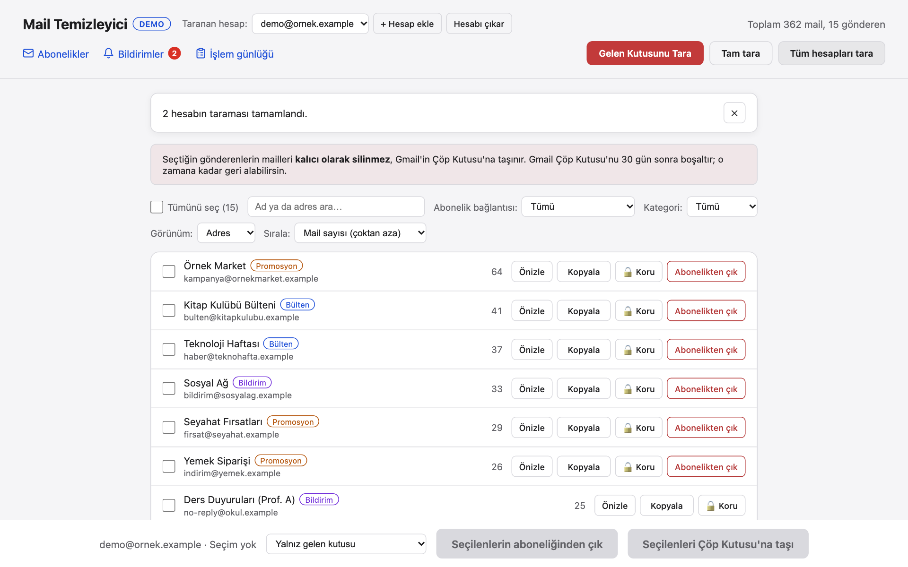
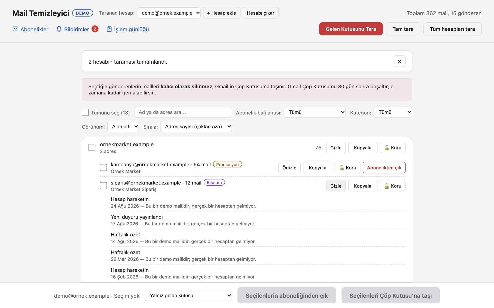
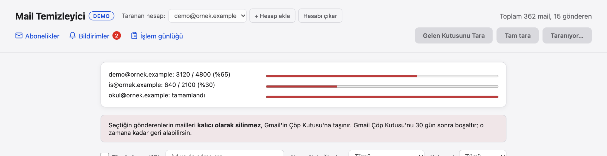
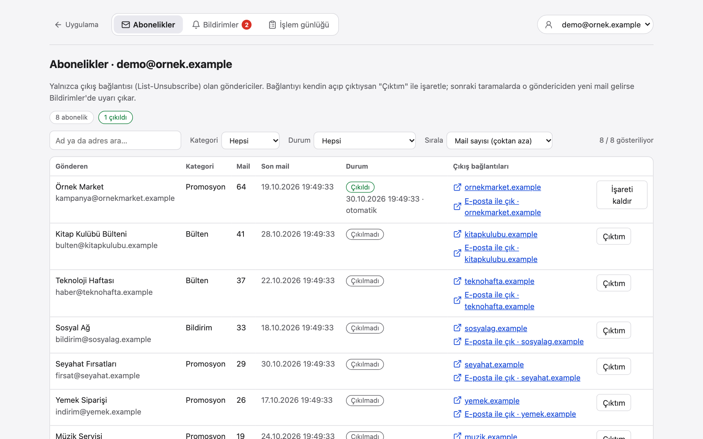
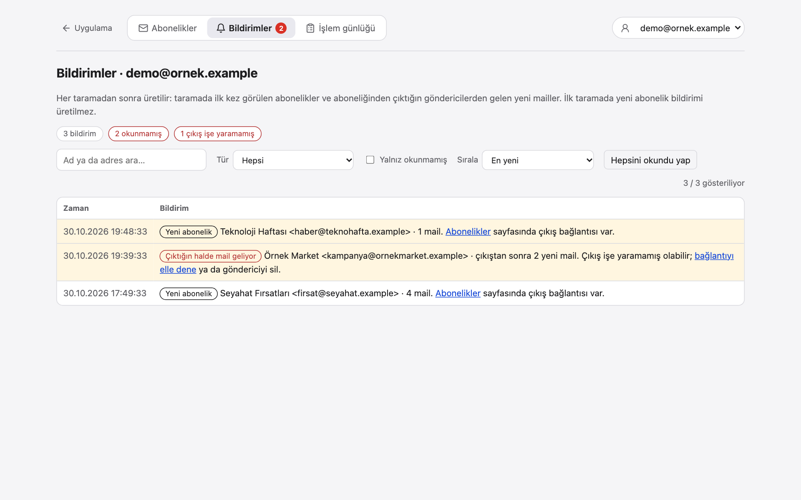
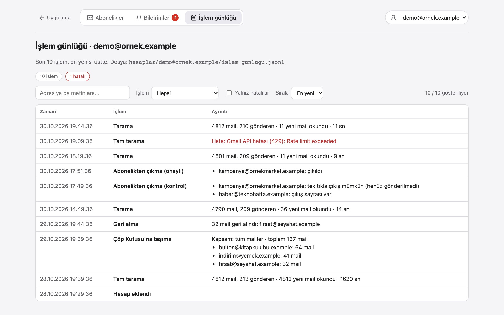

# Mail Sender Extractor

*Diğer diller: [🇹🇷 Türkçe](README.tr.md)*

A local web app that scans your Gmail (inbox, spam and archive), groups messages by sender, and
lets you bulk-trash or unsubscribe from the senders you pick, with an undo for the last delete.
It also lists every newsletter with its unsubscribe link, warns you when a sender keeps mailing
after you unsubscribed, and keeps a log of what you did. It runs only on your own machine
(`localhost`); nothing is sent anywhere except Gmail's own API.



*The screenshots use the built-in demo mode with fake data. The interface is in Turkish; this
README gives the English meaning of each label in parentheses.*

## Features

- **Background scan with progress:** scans the inbox, spam and archive (Trash, Sent and Drafts
  are skipped). Message metadata is fetched with Gmail batch requests, with a progress bar and a
  time estimate. Gmail allows about 300 message reads per minute per user, so the app paces itself
  to that quota instead of hitting rate limits (10,000 messages ≈ 35 minutes the first time).
  The headers it read are cached per account, so **later scans only read the new messages** and
  take seconds. **Full scan** (*Tam tara*) ignores the cache and re-reads everything, which also
  picks up category changes.
- **Scan all accounts at once:** Gmail counts the quota per account, so *Tüm hesapları tara*
  (scan all accounts) runs every account in parallel with one progress bar each. Four accounts
  take as long as the slowest one, not the sum.
- **One row per sender:** messages are grouped by the actual address; the same address with
  different display names is one row. Switch to a **domain view** to see `shop.com` as a whole.
- **Categories without a model:** each sender is tagged *newsletter / promotion / notification /
  personal / spam* from Gmail's own tabs (`CATEGORY_*` labels), the `SPAM` label and the
  `List-Unsubscribe` header.
- **Search, filters, sorting:** search by name or address; filter by category or by
  *subscription link* (all / with a link / without a link); sort by mail count or name, and in the
  domain view also by the number of addresses per domain. "Select all" only selects the rows you
  can see.
- **Per-address actions inside a domain:** open a domain and every address in it has its own
  select box, *Preview*, *Copy*, *Protect* and *Unsubscribe*.
- **Protected senders:** lock an address or a whole domain (`@bank.com`, subdomains included).
  Locked senders can't be selected, and the server refuses to trash or unsubscribe them.
- **Delete with the real count:** choose *inbox only* or *all mail* (archive and spam included);
  the confirm dialog shows how many messages will actually move to Trash.
- **Undo:** the last delete can be undone. Messages come back with their original inbox, unread
  and spam state, so archived mail doesn't land in the inbox.
- **Unsubscribe only where there is a link:** the *Unsubscribe* button appears only for senders
  whose unsubscribe link (`List-Unsubscribe`, `https` or `mailto:`) could be read. One-click
  unsubscribe (RFC 8058) is only sent after you confirm the list of senders; otherwise you get a
  link or `mailto:` address to open yourself.
- **Subscriptions page, notifications, activity log:** see [Pages](#pages).
- **Several Gmail accounts:** add accounts from the header and switch between them. Each account
  keeps its own sender list, scan, undo, subscriptions, notifications and log; the protected list
  is shared. Confirm dialogs name the account so you don't trash mail in the wrong one.
- **Preview and copy:** see a sender's latest subjects before deleting; copy an address.

## Screenshots

| | |
|---|---|
|  |  |
| **Main page:** one row per sender, with category, preview, copy, protect and unsubscribe. | **Domain view:** each address in a domain has its own actions and preview. |
|  |  |
| **Scan all accounts:** one progress bar per account, running in parallel. | **Subscriptions:** only senders with an unsubscribe link, with short link labels, filters and sorting. |
|  |  |
| **Notifications:** new subscriptions, and senders that mail you after you unsubscribed. | **Activity log:** scans, deletes, undos and unsubscribes, per account. |

Regenerate them with `python docs/make_screenshots.py` (demo mode, fake data only; needs
Chromium, see [Tests](#tests)).

## Pages

Besides the main page (`/`), the app has three pages that show **one account at a time**. Use the
account picker at the top (or `?account=<address>` in the URL). On the main page the links in the
header open them for the selected account.

| Page | Address | What it shows |
|---|---|---|
| Subscriptions (*Abonelikler*) | `/abonelikler` | Senders with a readable unsubscribe link: category, mail count, last mail, status (not unsubscribed / unsubscribed / unsubscribed but still mailing) and short link labels such as `emails.example.com` (the full address is in the tooltip and the link). *Çıktım* (I unsubscribed) marks a sender you unsubscribed from yourself. Search, filter by category and status, sort by mail count, last mail or name. |
| Notifications (*Bildirimler*) | `/bildirimler` | Created after each scan: a sender seen as a subscription for the first time (not on the very first scan), and a sender you unsubscribed from that **sent new mail after you unsubscribed**. The header shows a red bubble with the unread count. Filter by type, unread only, sort by time or mail count. |
| Activity log (*İşlem günlüğü*) | `/gunluk` | Scans (with how many new messages were read and how long it took), moves to Trash, undos, unsubscribes and account changes. Filter by type, errors only, sort by time. Stored in `hesaplar/<address>/islem_gunlugu.jsonl`. |

A sender is marked "unsubscribed" automatically after a confirmed one-click unsubscribe, or by
hand with *Çıktım*. Whether the unsubscribe really worked is only certain when no new mail comes
afterwards: the app counts mail that arrived after the mark and warns again whenever more has arrived since the last warning.

## Try it without a Gmail account (demo mode)

```bash
python3 -m venv venv
source venv/bin/activate
pip install -r requirements.txt
DEMO=1 python app.py
```

Open `http://localhost:5050`. Demo mode uses two in-memory fake accounts (about 500 messages);
data files go to a temporary folder and unsubscribe requests never leave your machine.

## Use it with your Gmail

There is no "main" account: **every Gmail account connects on its own**, with an OAuth client
from its own Google Cloud project. Nobody else's project, approval or test-user list is involved.
Do steps 1–2 once, then steps 3–4 for **each** account you want to add.

### 1. Install

```bash
git clone https://github.com/dogukannparlak/mail-sender-extractor.git
cd mail-sender-extractor
python3 -m venv venv
source venv/bin/activate
pip install -r requirements.txt
cp .env.example .env        # optional: settings, see "Settings" below
```

### 2. Run

```bash
source venv/bin/activate
python app.py
```

Open `http://localhost:5050`. Keep this terminal open while you use the app; `Ctrl+C` stops it.

### 3. Google Cloud setup (once per account, ~10 minutes)

Sign in to the [Google Cloud Console](https://console.cloud.google.com/) **with the Gmail account
you are about to add**. Google renames menu items now and then; if a name differs, look for the
closest one.

1. **Create a project.** Click the project picker at the top › **New project** › give it a name
   (e.g. `mail-cleaner`) › **Create**. Make sure the new project is selected at the top.
2. **Turn on the Gmail API.** Open
   [APIs & Services › Library › Gmail API](https://console.cloud.google.com/apis/library/gmail.googleapis.com)
   and click **Enable**.
3. **Set up the sign-in screen.** Open
   [Google Auth Platform](https://console.cloud.google.com/auth/overview) › **Get started**:
   - **App information:** any app name (e.g. `Mail Cleaner`) and your address as support email.
   - **Audience:** **External**.
   - **Contact information:** your address. Accept the policy › **Create**.
4. **Add yourself as a test user** (needed even though it is your own project).
   **Audience** › **Test users** › **Add users** › type the Gmail address of this account followed
   by a comma, so it turns into a chip › **Save**. Check that the list now shows "1 user (1 test)".
   Without this, sign-in fails with `Error 403: access_denied`.
5. **Allow the Gmail permission** (recommended). **Data access** › **Add or remove scopes** › find
   `https://www.googleapis.com/auth/gmail.modify` (or paste it under "Manually add scopes") ›
   **Update** › **Save**.
6. **Create the client.** **Clients** › **Create client** › Application type **Desktop app** › any
   name › **Create** › **Download JSON**. You get a file like `client_secret_1234….json`.
   Keep it private: it identifies your project.

### 4. Add the account in the app

1. Click **+ Add account** at the top of the page.
2. Choose the `client_secret_….json` file from step 3.6.
3. A Google window opens. Pick **the same account**, then:
   - "Google hasn't verified this app" appears because the project is in testing mode and only
     you use it. Click **Continue**.
   - Allow access to Gmail (read and change, so the app can move mail to Trash).
4. Back in the app you see "<address> added". Click **Scan Inbox** (*Gelen Kutusunu Tara*).

The app stores that account's client file and sign-in token in `hesaplar/<address>/` (git
ignores this folder). Deleted messages go to Gmail's **Trash**, not straight to permanent
deletion; Gmail empties the Trash after 30 days.

**Other ways to add an account:**

| You have | Do this |
|---|---|
| The account's `client_secret_….json` and want to prepare folders by hand | Create `hesaplar/<address>/`, put the file there as `credentials.json`. The account shows up in **+ Add account** as "waiting for sign-in"; click it. Signing in with a different Google account is refused. |
| A ready `token.json` made with that account's client | Put it in `tokenlar/` and add a line `ACCOUNT_2=<address>=tokenlar/<file>.json` to `.env` (see "Settings"). |
| One shared `credentials.json` in the project folder | Still works: **+ Add account** offers it. Then every account must be a test user of that one project. |

**Testing mode note:** Google may sign apps in testing mode out after about 7 days. When that
happens the app says the session expired: **Remove account**, then add it again with the same
file. (Publishing the app in Google Auth Platform › Audience avoids this, at the cost of an
"unverified app" warning; I have not verified Google's current rules for this.)

### 5. Multiple accounts

You can manage several Gmail accounts (personal, school, work) from the same page.

1. **Add:** follow steps 3–4 above for each account. Google shows its account picker, so the
   account that happens to be signed in to your browser is not chosen silently.
2. **Switch:** choose the account in the picker at the top. The list, selection, previews and
   "Undo" belong to that account; switching never carries a selection over.
3. **Work:** scan, trash, undo and unsubscribe always act on the selected account only. The confirm
   dialog and the bottom bar show the account name, so you can't trash mail in the wrong one.
4. **Remove:** **Remove account** deletes only that account's sign-in token on this computer. Your
   mail is not touched, and the saved sender list stays, so re-adding the account brings it back.
   To revoke the app's access at Google as well, use
   [myaccount.google.com/permissions](https://myaccount.google.com/permissions).

| What | Per account or shared? |
|---|---|
| Google Cloud client, sign-in token, sender list, scan index and cache, last-trash record, subscriptions, notifications, activity log | Per account: `hesaplar/<address>/` |
| Protected senders (`korunanlar.json`) | Shared: a bank you lock is protected in every account |
| Gmail quota (~300 message reads per minute) | Gmail counts it per account, and so does the app: every account has its own budget, so several accounts can be scanned at the same time (*Scan all accounts*) |

**Upgrading from the single-account version:** on first start an existing `token.json` and its
data files (`gonderenler.csv`, `taranan_idler.json`, `son_islem.json`) are moved into the folder of
the account they belong to, and so is `credentials.json` if that token was made with it. The page
tells you which account they were moved to.

### 6. Settings (`.env`)

Settings live in a `.env` file in the project folder (not committed). Start from the example:

```bash
cp .env.example .env
```

| Setting | Default | What it does |
|---|---|---|
| `PORT` | `5050` | Port of `http://localhost:<PORT>` |
| `DEMO` | `0` | `1` = demo mode with fake accounts, no Gmail |
| `FLASK_DEBUG` | `0` | Flask debug mode (development only) |
| `COMPACT_FILES` | `0` | `0` = the JSON files the app writes are indented and easy to read, `1` = one compact line |
| `CREDENTIALS_PATH` | `credentials.json` | Optional shared OAuth client; normally each account brings its own file instead |
| `ACCOUNTS_DIR` | `hesaplar` | Folder with one sub-folder per account |
| `ACCOUNT_1`, `ACCOUNT_2`, … | empty | One line per account whose token file you already have: `address=token_path` (e.g. `tokenlar/second.json`) |
| `EXTRA_ACCOUNTS` | empty | The same on one line: `address=token_path, address=token_path` |
| `GMAIL_QUOTA_PER_MINUTE` | `5400` | Quota units per minute the app allows itself (Gmail's limit is 6,000) |
| `DEFAULT_SCOPE` | `inbox` | Default delete/preview scope: `inbox` or `all` |

A value given on the command line wins over `.env` (`DEMO=1 python app.py`). Relative paths are
relative to the project folder; `~` is expanded. A wrong value stops the app at start with a
message naming the setting. Accounts listed in `ACCOUNT_n` / `EXTRA_ACCOUNTS` can't be removed from the page
(the token file is yours); delete the line instead.

### CSV only (CLI)

```bash
python extract_senders.py                    # the only account, if there is just one
python extract_senders.py someone@gmail.com  # a specific account
```

Writes that account's `hesaplar/<address>/gonderenler.csv`: one row per address with display name,
count, category and whether an unsubscribe link was seen. Older CSV files (raw `From` header +
count) are still read and merged by address.

## How it works

```
browser (templates/index.html, abonelikler.html, bildirimler.html, gunluk.html)
   │  fetch, same-origin only
   ▼
Flask app.py ── Host / Origin checks ── Gmail API (google-api-python-client)
   │                                     ├─ messages.list  (scan: -in:trash -in:sent -in:drafts, spam included;
   │                  delete/preview: from:"addr" in:inbox | -in:trash)
   │                                     ├─ batch messages.get (metadata)
   │                                     ├─ messages.batchModify (TRASH)
   │                                     └─ batch messages.untrash (undo)
   └─ local files: hesaplar/<address>/{token.json, gonderenler.csv, taranan_idler.json,
                   tarama_onbellegi.json, son_islem.json, abonelikler.json, bildirimler.json,
                   islem_gunlugu.jsonl} · korunanlar.json (shared)
```

Entry points in the project folder: `app.py` (web app), `demo.py` (demo mode), `extract_senders.py`
(CLI). The code lives in the `mail_temizleyici/` package, one module per job:

| Module | What it does |
|---|---|
| `config.py` | Reads `.env` and checks the values |
| `auth.py` | Google sign-in, one token per account (`0600`) |
| `gmail.py` | Shared Gmail API parts: address parsing, per-account quota limiter, batch requests with retry |
| `scanner.py` | Scan of inbox, spam and archive with a per-message cache: count per address, display name, categories; CSV read/write |
| `accounts.py` | Account folders, account list, moving the old single-account files |
| `protected.py` | Protected senders (shared by all accounts) |
| `state.py` | Per-account scan/delete state and locks |
| `mailbox.py` | Count, move to Trash, undo, preview (with exact sender check) |
| `unsubscribe.py` | List-Unsubscribe and one-click unsubscribe with SSRF checks |
| `subscriptions.py` | Subscription list, "unsubscribed" marks, notifications created after a scan |
| `activity.py` | Per-account activity log (one JSON object per line) |
| `web.py` | Flask app: page, JSON API, request checks, error mapping |
| `demo.py` | Fake mailboxes for demo mode |
| `templates/` | The main page and the subscriptions, notifications and log pages (plain JS, no build step) |
| `docs/make_screenshots.py` | Regenerates the README screenshots in demo mode |

## Security notes

The app holds a token that can modify your mail, so it is built to be reachable only from your
own browser on `localhost`:

- Requests with any `Host` other than `localhost` / `127.0.0.1` / `[::1]` are rejected
  (DNS rebinding), and cross-site `POST`s are rejected using `Sec-Fetch-Site` and `Origin`.
- Sender addresses are parsed and validated before they go into a Gmail search, so a crafted
  `From` header can't widen the query (e.g. `x@y.com OR label:inbox`).
- Everything coming from mail headers is HTML-escaped before it reaches the page.
- One-click unsubscribe only goes to `https` URLs on public IP addresses, without following
  redirects, and only after you confirm.
- Unsubscribe links shown on the Subscriptions page are limited to `http`, `https` and `mailto:` and open with `rel="noopener noreferrer"`; anything else (e.g. `javascript:`) is dropped.
- `credentials.json`, the `hesaplar/` folder (tokens, scan cache, notifications, activity log) and the local data files are in `.gitignore`. The cache and log contain sender addresses and stay on your machine.

Don't expose this app on a network or run it on a shared server.

## Tests

The `pytest` suite runs against a fake Gmail service; no real account or network is touched.
`tests/test_ui.py` drives the page in headless Chromium against demo mode (skipped if Chromium
isn't installed).

```bash
pip install -r requirements-dev.txt
python -m playwright install chromium   # for the browser tests in tests/test_ui.py and docs/make_screenshots.py
python -m pytest tests/ -v
```

## Notes

- The token uses the `gmail.modify` scope (read + modify), because the web app moves messages
  to Trash. `extract_senders.py` only reads, but shares the same token.
- If an account's sign-in stops working (expired or revoked), remove it in the header and add it again.
