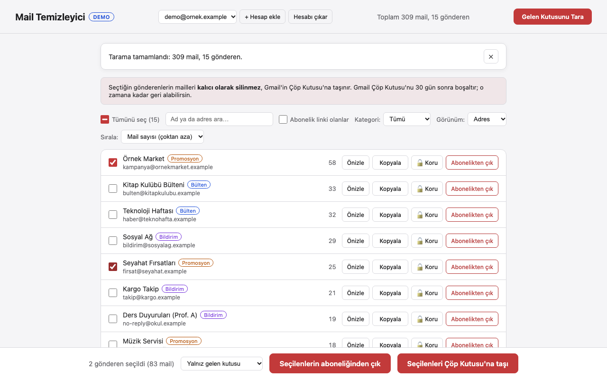

# Mail Sender Extractor

*Other languages: [🇬🇧 English](README.md)*

Gmail gelen kutunu tarayan, mailleri gönderene göre gruplayan ve seçtiğin gönderenlerin
maillerini toplu olarak çöpe taşımanı ya da abonelikten çıkmanı sağlayan yerel bir web
uygulaması. Son silme geri alınabilir. Yalnız kendi bilgisayarında (`localhost`) çalışır;
Gmail'in kendi API'si dışında hiçbir yere veri gitmez.



## Özellikler

- **Arka planda tarama ve ilerleme çubuğu:** mail bilgileri arka planda Gmail batch
  istekleriyle alınır; sayfada ilerleme ve kalan süre görünür. Gmail kullanıcı başına dakikada
  yaklaşık 300 mail okumaya izin veriyor; uygulama hız sınırına çarpmak yerine bu kotaya göre
  ilerler (10.000 mail ≈ 35 dakika). Sonraki silmeler taramada görüleni yeniden kullanır.
- **Gönderen başına tek satır:** sayım gerçek adrese göre yapılır; aynı adres farklı adlarla
  gelse de tek satırdır. **Alan adı görünümü** ile `magaza.com`'u bütün olarak görebilirsin.
- **Modelsiz kategori:** her gönderen Gmail'in kendi sekmelerinden (`CATEGORY_*` etiketleri)
  ve `List-Unsubscribe` başlığından *bülten / promosyon / bildirim / kişisel* olarak etiketlenir.
- **Arama ve filtre:** ad ya da adresle ara; kategoriye ya da "abonelik linki olanlar"a göre
  süz. "Tümünü seç" yalnız ekranda görünen satırları seçer.
- **Korunan gönderenler:** bir adresi ya da alan adının tamamını kilitle (`@banka.com`, alt
  alan adları dahil). Kilitli gönderenler seçilemez; sunucu da onları silmeyi ve abonelikten
  çıkmayı reddeder.
- **Gerçek sayıyla silme:** *yalnız gelen kutusu* ya da *tüm mailler (arşiv dahil)* seç; onay
  penceresi Çöp Kutusu'na gerçekten kaç mail gideceğini gösterir.
- **Geri al:** son silme geri alınabilir. Mailler eski gelen kutusu/okunmadı durumlarıyla
  döner; arşivdeki mailler gelen kutusuna düşmez.
- **Onaylı abonelikten çıkma:** tek tıkla çıkış (RFC 8058) yalnız gönderen listesini onayladıktan
  sonra gönderilir; aksi halde kendin açacağın bir link ya da `mailto:` adresi verilir.
- **Önizleme ve kopyalama:** silmeden önce gönderenin son konularını gör; adresi kopyala.

## Gmail hesabı olmadan dene (demo modu)

```bash
python3 -m venv venv
source venv/bin/activate
pip install -r requirements.txt
DEMO=1 python app.py
```

`http://localhost:5050` adresini aç. Demo modu bellekte yaklaşık 360 sahte mail içeren bir
posta kutusu kullanır; veri dosyaları geçici bir klasöre yazılır, abonelik istekleri
bilgisayarından çıkmaz.

## Kendi Gmail'inle kullan

### 1. Google Cloud kimlik bilgisi (`credentials.json`)

1. [Google Cloud Console](https://console.cloud.google.com/)'da bir proje oluştur (ya da seç).
2. **APIs & Services > Library** altında **Gmail API**'yi etkinleştir.
3. **APIs & Services > Credentials** altında **Create Credentials > OAuth client ID** seç,
   uygulama türü **Desktop app**.
4. İndirdiğin JSON dosyasını bu klasöre `credentials.json` adıyla kaydet.

### 2. Çalıştır

```bash
source venv/bin/activate
python app.py
```

`http://localhost:5050` adresini aç ve **Gelen Kutusunu Tara**'ya bas. İlk seferde bir tarayıcı
penceresi Google girişi ister; sonra `token.json` dosyası oturumu açık tutar.

Silinen mailler doğrudan kalıcı olarak silinmez, Gmail'in **Çöp Kutusu**'na taşınır. Gmail çöp
kutusunu 30 gün sonra boşaltır.

### Yalnız CSV (CLI)

```bash
python extract_senders.py
```

`gonderenler.csv` dosyasına adres başına bir satır yazar: adres, görünen ad, sayı, kategori ve
abonelik linki görülüp görülmediği. Eski CSV dosyaları (ham `From` başlığı + sayı) hâlâ okunur
ve adrese göre birleştirilir.

## Nasıl çalışır

```
tarayıcı (templates/index.html)
   │  fetch, yalnız aynı kaynaktan
   ▼
Flask app.py ── Host / Origin kontrolü ── Gmail API (google-api-python-client)
   │                                       ├─ messages.list  (from:"adres" in:inbox)
   │                                       ├─ batch messages.get (metadata)
   │                                       ├─ messages.batchModify (TRASH)
   │                                       └─ batch messages.untrash (geri al)
   └─ yerel dosyalar: gonderenler.csv · korunanlar.json · son_islem.json
```

| Dosya | İçinde ne var |
|---|---|
| `app.py` | Web sunucusu ve API: tarama, sayım, silme, geri alma, önizleme, abonelik, korunanlar |
| `extract_senders.py` | Tarama mantığı (batch okuma, gruplama, kategori) ve CSV okuma/yazma; ayrıca CLI |
| `gmail_auth.py` | OAuth girişi; `token.json` `0600` izniyle yazılır |
| `demo.py` | Demo modu için sahte posta kutusu |

## Güvenlik notları

Uygulama maillerini değiştirebilen bir token tutar; bu yüzden yalnız kendi tarayıcından,
`localhost` üzerinden erişilecek şekilde kuruldu:

- `localhost` / `127.0.0.1` / `[::1]` dışındaki bir `Host` ile gelen istekler reddedilir
  (DNS rebinding); başka sitelerden gelen `POST`'lar `Sec-Fetch-Site` ve `Origin` ile reddedilir.
- Gönderen adresleri Gmail aramasına girmeden önce ayrıştırılıp doğrulanır; hazırlanmış bir
  `From` başlığı sorguyu genişletemez (ör. `x@y.com OR label:inbox`).
- Mail başlıklarından gelen her şey sayfaya girmeden önce HTML olarak kaçırılır.
- Tek tıkla çıkış yalnız genel IP'deki `https` adreslerine, yönlendirme izlenmeden ve yalnız
  sen onayladıktan sonra gönderilir.
- `credentials.json`, `token.json` ve yerel veri dosyaları `.gitignore`'da.

Uygulamayı bir ağa açma ya da ortak bir sunucuda çalıştırma.

## Testler

`pytest` testleri sahte bir Gmail servisine karşı çalışır; gerçek hesaba ya da ağa dokunmaz.
`tests/test_ui.py` sayfayı demo moduna karşı headless Chromium'da kullanır (Chromium kurulu
değilse atlanır).

```bash
pip install -r requirements-dev.txt
python -m playwright install chromium   # yalnız tests/test_ui.py tarayıcı testleri için
python -m pytest tests/ -v
```

## Notlar

- Token `gmail.modify` iznini (okuma + değiştirme) kullanır, çünkü web uygulaması mailleri
  Çöp Kutusu'na taşır. `extract_senders.py` yalnız okur ama aynı token'ı paylaşır.
- İzin değişikliğinden önce oluşmuş bir `token.json`'ın varsa sil ve yeniden giriş yap.
