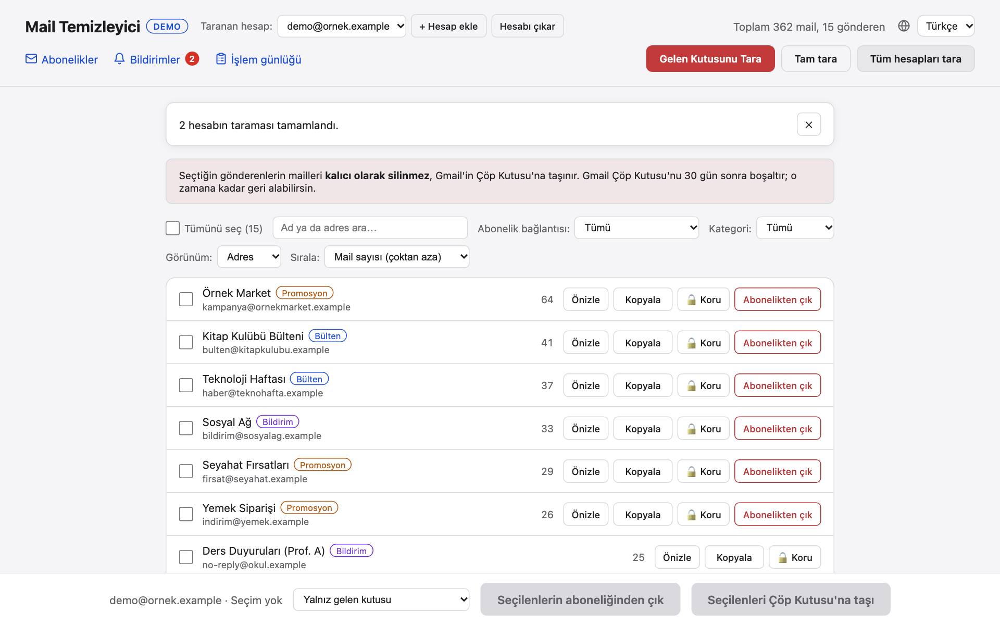

# Mail Sender Extractor (Türkçe doküman)

*Other languages: [🇬🇧 English](../doc/README.md)* · [Proje README'si (İngilizce)](../README.md)

Gmail'ini (gelen kutusu, spam ve arşiv) tarayan, mailleri gönderene göre gruplayan ve seçtiğin gönderenlerin maillerini toplu olarak
çöpe taşımanı ya da abonelikten çıkmanı sağlayan yerel bir web uygulaması. Son silme geri alınabilir. Ayrıca bütün bültenleri çıkış
linkleriyle listeler, abonelikten çıktığın bir gönderen mail atmaya devam ederse uyarır ve yaptığın işlemleri günlüğe yazar. Arayüz
**English** ve **Türkçe** olarak kullanılabilir. Yalnız kendi bilgisayarında (`localhost`) çalışır; Gmail'in kendi API'si dışında
hiçbir yere veri gitmez.



## Öne çıkanlar

- Hızlı yeniden tarama: başlıklar önbelleğe alınır, sonraki taramalar yalnız yeni mailleri okur; birkaç hesap **aynı anda** taranabilir.
- Gönderen başına tek satır, adres başına işlemli **alan adı görünümü**, arama, filtre ve sıralama, modelsiz kategori.
- Güvenli silme: gerçek sayıyla Çöp Kutusu'na taşıma, **geri al**, korunan gönderenler; abonelikten çıkma yalnız bağlantı varsa, tek tıkla çıkış yalnız onaydan sonra.
- Her hesap için **Abonelikler**, **Bildirimler** ve **İşlem günlüğü** sayfaları.
- Her Gmail hesabı kendi Google Cloud istemcisiyle bağlanır; ortak proje ya da test kullanıcı listesi gerekmez.

## Hızlı başlangıç

Gmail hesabı olmadan dene (sahte veri, bilgisayarından hiçbir şey çıkmaz):

```bash
git clone https://github.com/dogukannparlak/mail-sender-extractor.git
cd mail-sender-extractor
python3 -m venv venv
source venv/bin/activate
pip install -r requirements.txt
DEMO=1 python app.py
```

`http://localhost:5050` adresini aç. Gerçek Gmail'inle kullanmak için [kurulum rehberini](setup.md) izle.

## Doküman

| Rehber | İçinde ne var |
|---|---|
| [Kurulum](setup.md) | Demo modu, kurulum, Google Cloud istemcisi, bir ya da birkaç Gmail hesabı ekleme |
| [Özellikler](features.md) | Uygulamanın yaptığı her şey, ekran görüntüleri, Abonelikler / Bildirimler / İşlem günlüğü sayfaları |
| [Yapılandırma](configuration.md) | `.env` ayarları, arayüz dili, komut satırı aracı |
| [Mimari](architecture.md) | Nasıl çalışır, proje yapısı, ön yüz ve çeviri yapısı, güvenlik notları |
| [Geliştirme](development.md) | Testler, ekran görüntülerini yeniden üretme, dil ekleme |
