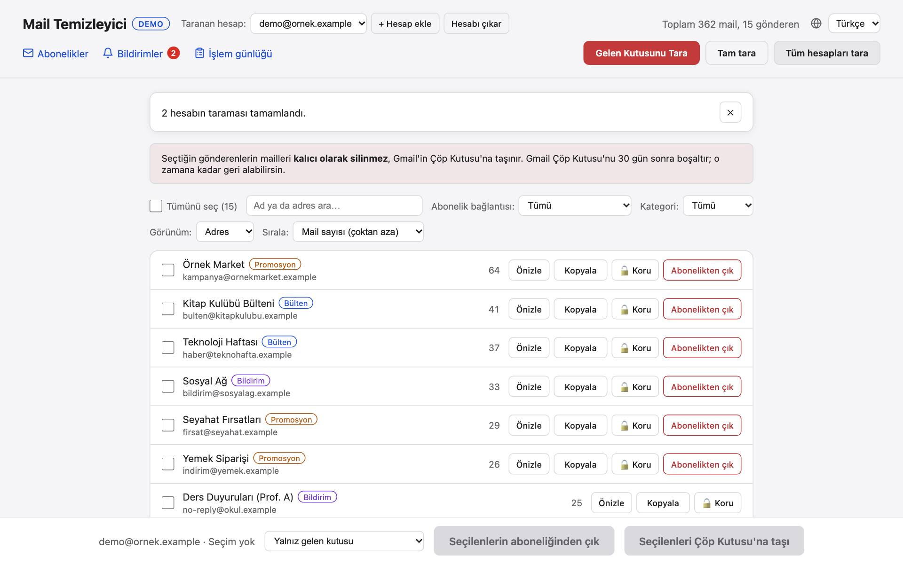
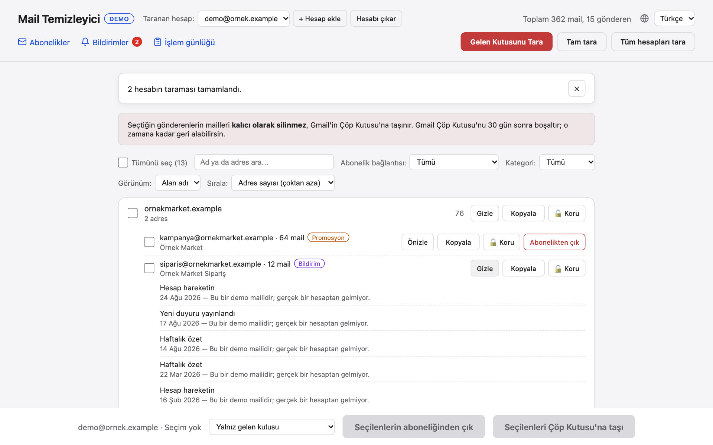
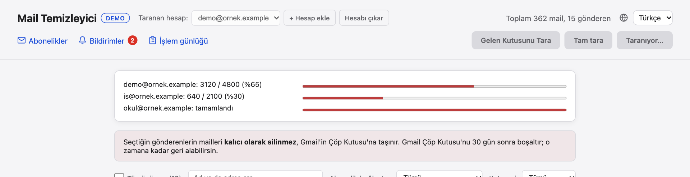
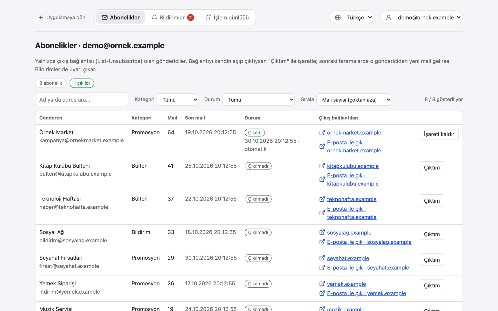
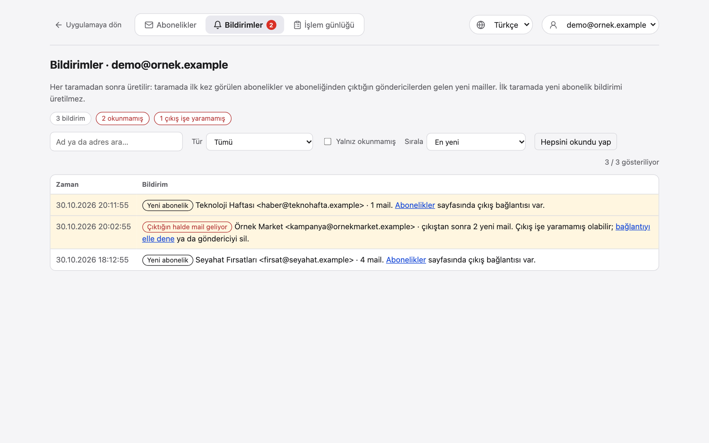
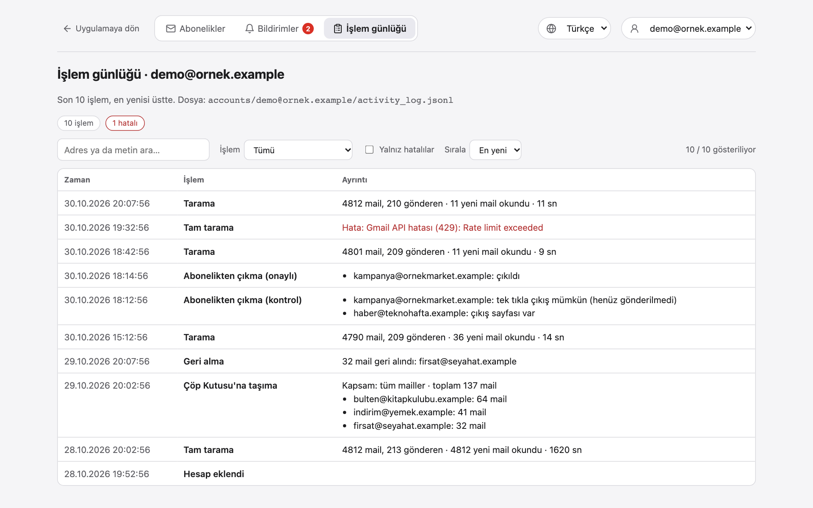

# Özellikler

- **Arka planda tarama ve ilerleme çubuğu:** gelen kutusunu, spam'i ve arşivi tarar (Çöp, Gönderilenler ve Taslaklar atlanır). Mail
  bilgileri Gmail batch istekleriyle alınır; sayfada ilerleme ve kalan süre görünür. Gmail kullanıcı başına dakikada yaklaşık 300 mail
  okumaya izin veriyor; uygulama hız sınırına çarpmak yerine bu kotaya göre ilerler (10.000 mail ilk seferde ≈ 35 dakika). Okunan
  başlıklar hesap başına saklanır; bu yüzden **sonraki taramalar yalnız yeni mailleri okur** ve saniyeler sürer. **Tam tara** önbelleği
  yok sayıp her şeyi yeniden okur (kategori değişikliklerini de yakalar).
- **Bütün hesapları aynı anda tara:** Gmail kotayı hesap başına sayar; **Tüm hesapları tara** her hesabı paralel çalıştırır, her biri
  için ayrı ilerleme çubuğu gösterir. Dört hesap, toplamı kadar değil en yavaş hesap kadar sürer.
- **Gönderen başına tek satır:** sayım gerçek adrese göre yapılır; aynı adres farklı adlarla gelse de tek satırdır. **Alan adı
  görünümü** ile `magaza.com`'u bütün olarak görebilirsin.
- **Modelsiz kategori:** her gönderen Gmail'in kendi sekmelerinden (`CATEGORY_*` etiketleri), `SPAM` etiketinden ve `List-Unsubscribe`
  başlığından *bülten / promosyon / bildirim / kişisel / spam* olarak etiketlenir.
- **Arama, filtre, sıralama:** ad ya da adresle ara; kategoriye ya da *abonelik bağlantısına* (tümü / olanlar / olmayanlar) göre süz;
  mail sayısına ya da isme göre sırala, alan adı görünümünde ayrıca alan adı başına adres sayısına göre. "Tümünü seç" yalnız ekranda
  görünen satırları seçer.
- **Alan adının içinde adres başına işlem:** bir alan adını açınca içindeki her adresin kendi seçim kutusu, *Önizle*, *Kopyala*, *Koru*
  ve *Abonelikten çık* düğmeleri vardır.
- **Korunan gönderenler:** bir adresi ya da alan adının tamamını kilitle (`@banka.com`, alt alan adları dahil). Kilitli gönderenler
  seçilemez; sunucu da onları silmeyi ve abonelikten çıkmayı reddeder.
- **Gerçek sayıyla silme:** *yalnız gelen kutusu* ya da *tüm mailler* (arşiv ve spam dahil) seç; onay penceresi Çöp Kutusu'na gerçekten
  kaç mail gideceğini gösterir.
- **Geri al:** son silme geri alınabilir. Mailler eski gelen kutusu, okunmadı ve spam durumlarıyla döner; arşivdeki mailler gelen
  kutusuna düşmez.
- **Abonelikten çıkma yalnız bağlantı varsa:** *Abonelikten çık* düğmesi yalnız çıkış bağlantısı (`List-Unsubscribe`, `https` ya da
  `mailto:`) okunabilen göndericilerde görünür. Tek tıkla çıkış (RFC 8058) yalnız gönderen listesini onayladıktan sonra gönderilir; aksi
  halde kendin açacağın bir link ya da `mailto:` adresi verilir.
- **Abonelikler sayfası, bildirimler, işlem günlüğü:** bkz. [Sayfalar](#sayfalar).
- **Birden fazla Gmail hesabı:** başlıktan hesap ekle ve hesaplar arasında geçiş yap. Her hesabın gönderen listesi, taraması, geri alması,
  abonelikleri, bildirimleri ve günlüğü ayrıdır; korunanlar listesi ortaktır. Onay pencereleri hesabı yazar, yanlış hesapta mail taşınmaz.
- **İngilizce ve Türkçe arayüz:** dili sayfa başlığından seç; bkz. [Dil](configuration.md#dil).
- **Önizleme ve kopyalama:** silmeden önce gönderenin son konularını gör; adresi kopyala.

## Ekran görüntüleri

| | |
|---|---|
|  |  |
| **Ana sayfa:** gönderen başına bir satır; kategori, önizleme, kopyalama, koruma ve abonelikten çıkma. | **Alan adı görünümü:** alan adının içindeki her adresin kendi işlemleri ve önizlemesi var. |
|  |  |
| **Tüm hesapları tara:** hesap başına bir ilerleme çubuğu, paralel çalışır. | **Abonelikler:** yalnız çıkış bağlantısı olan göndericiler; kısa bağlantı etiketleri, filtre ve sıralama. |
|  |  |
| **Bildirimler:** yeni abonelikler ve abonelikten çıktıktan sonra mail atan göndericiler. | **İşlem günlüğü:** tarama, silme, geri alma ve abonelikten çıkma kayıtları, hesap başına. |

Ekran görüntüleri yerleşik demo modunun sahte verileriyle alındı. İngilizce arayüzlü sürümler [doc/screenshots](../doc/screenshots)
klasöründe. İkisini de `python scripts/make_screenshots.py` ile yeniden üretebilirsin (bkz. [development.md](development.md#ekran-görüntüleri)).

## Sayfalar

Ana sayfanın (`/`) yanında **her seferinde tek hesabı** gösteren üç sayfa vardır. Üstteki hesap seçiciyi (ya da adreste
`?account=<adres>`) kullan. Ana sayfada başlıktaki bağlantılar seçili hesap için açar.

| Sayfa | Adres | Ne gösterir |
|---|---|---|
| Abonelikler | `/subscriptions` | Okunabilir çıkış bağlantısı olan göndericiler: kategori, mail sayısı, son mail, durum (çıkılmadı / çıkıldı / çıkıldı ama hâlâ mail atıyor) ve `emails.ornek.com` gibi kısa bağlantı etiketleri (tam adres ipucunda ve linkte). **Çıktım** kendin çıktığın göndericiyi işaretler. Arama, kategori ve duruma göre filtre, mail sayısı / son mail / isme göre sıralama. |
| Bildirimler | `/notifications` | Her taramadan sonra üretilir: taramada ilk kez görülen abonelikler (ilk taramada değil) ve abonelikten çıktığın ama **çıkıştan sonra yeni mail gönderen** göndericiler. Başlıkta okunmamış sayısı kırmızı baloncukla görünür. Türe göre, yalnız okunmamışlara göre filtre; zamana ya da mail sayısına göre sıralama. |
| İşlem günlüğü | `/activity-log` | Taramalar (kaç yeni mail okundu, ne kadar sürdü), Çöp Kutusu'na taşıma, geri alma, abonelikten çıkma ve hesap değişiklikleri. Türe göre, yalnız hatalılara göre filtre; zamana göre sıralama. `accounts/<adres>/activity_log.jsonl` dosyasında durur. |

Bir gönderen onaylı tek tıkla çıkıştan sonra kendiliğinden, ya da **Çıktım** ile elle "çıkıldı" olarak işaretlenir. Çıkışın gerçekten
işe yaradığı ancak sonrasında mail gelmeyince kesinleşir: uygulama işaretten sonra gelen mailleri sayar ve son uyarıdan sonra daha fazla
mail gelirse yeniden uyarır.
