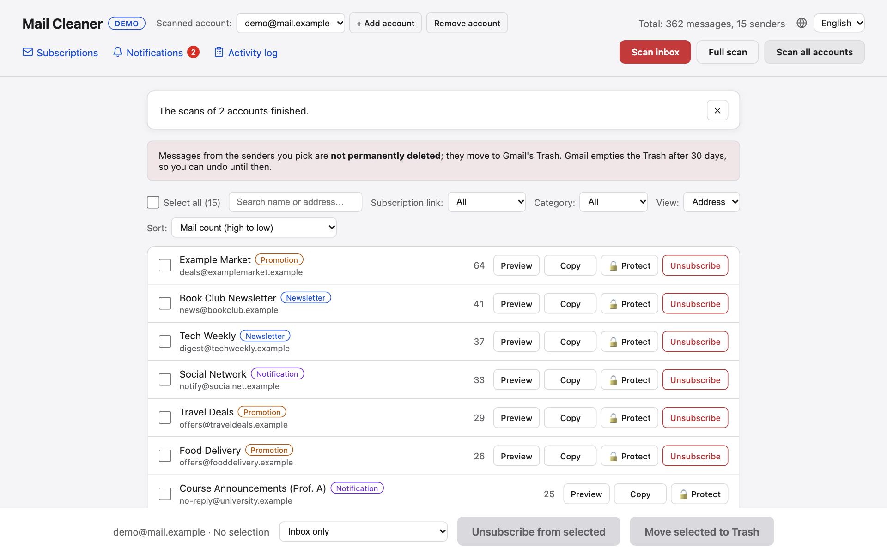

# Documentation

*Other languages: [🇹🇷 Türkçe](../doc-tr/README.md)* · Back to the [project README](../README.md)

| Guide | What is in it |
|---|---|
| [Setup](setup.md) | Demo mode, installing, the Google Cloud client, adding one or several Gmail accounts |
| [Features](features.md) | Everything the app does, screenshots, the Subscriptions / Notifications / Activity log pages |
| [Configuration](configuration.md) | `.env` settings, interface language, the command-line tool |
| [Architecture](architecture.md) | How it works, project layout, front-end and translation structure, security notes |
| [Development](development.md) | Tests, regenerating screenshots, adding a language |
