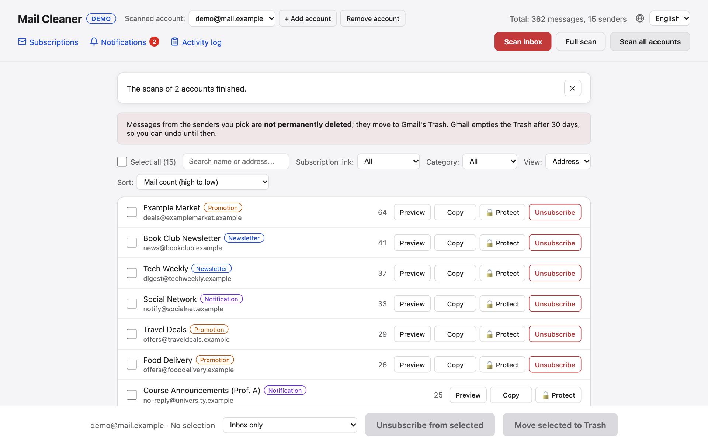
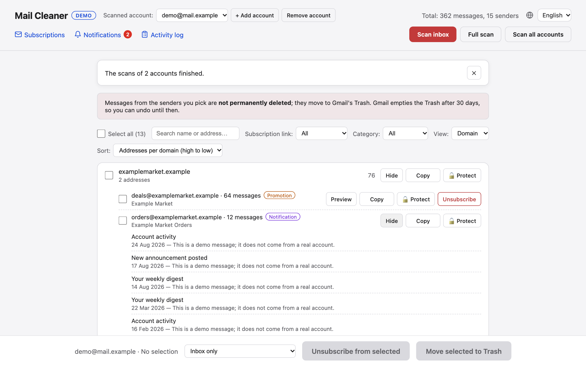
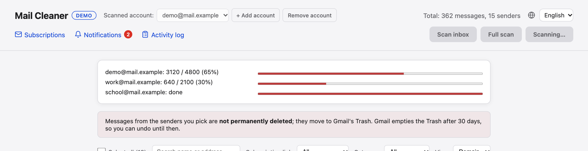
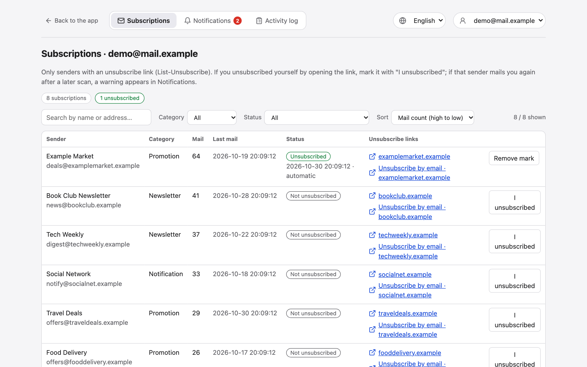
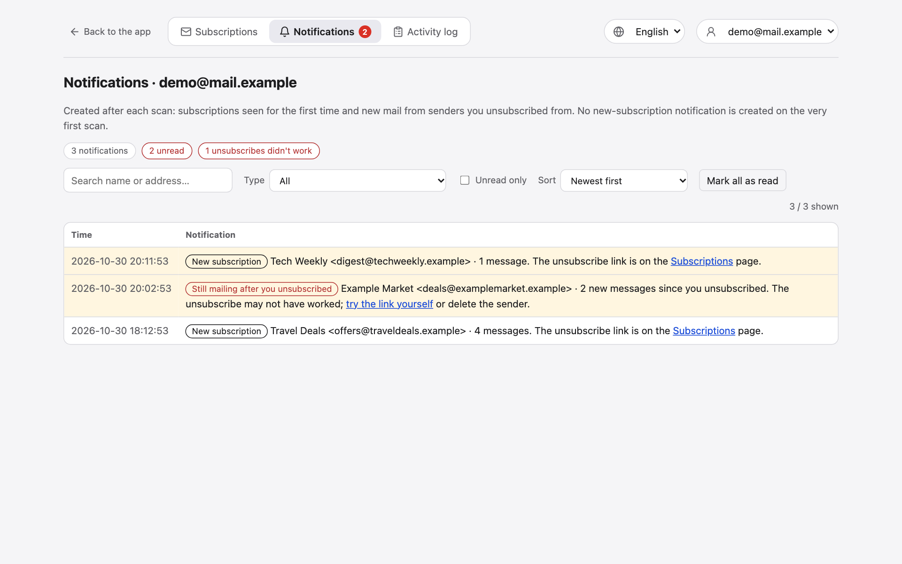
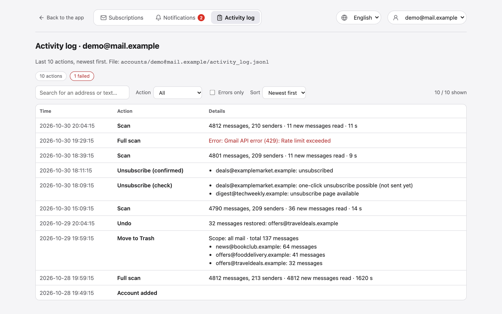

# Features

- **Background scan with progress:** scans the inbox, spam and archive (Trash, Sent and Drafts are skipped). Message metadata is
  fetched with Gmail batch requests, with a progress bar and a time estimate. Gmail allows about 300 message reads per minute per
  user, so the app paces itself to that quota instead of hitting rate limits (10,000 messages ≈ 35 minutes the first time). The headers
  it read are cached per account, so **later scans only read the new messages** and take seconds. **Full scan** ignores the cache and
  re-reads everything, which also picks up category changes.
- **Scan all accounts at once:** Gmail counts the quota per account, so **Scan all accounts** runs every account in parallel with one
  progress bar each. Four accounts take as long as the slowest one, not the sum.
- **One row per sender:** messages are grouped by the actual address; the same address with different display names is one row.
  Switch to the **domain view** to see `shop.com` as a whole.
- **Categories without a model:** each sender is tagged *newsletter / promotion / notification / personal / spam* from Gmail's own
  tabs (`CATEGORY_*` labels), the `SPAM` label and the `List-Unsubscribe` header.
- **Search, filters, sorting:** search by name or address; filter by category or by *subscription link* (all / with a link / without a
  link); sort by mail count or name, and in the domain view also by the number of addresses per domain. "Select all" only selects the
  rows you can see.
- **Per-address actions inside a domain:** open a domain and every address in it has its own select box, *Preview*, *Copy*,
  *Protect* and *Unsubscribe*.
- **Protected senders:** lock an address or a whole domain (`@bank.com`, subdomains included). Locked senders can't be selected, and
  the server refuses to trash or unsubscribe them.
- **Delete with the real count:** choose *inbox only* or *all mail* (archive and spam included); the confirm dialog shows how many
  messages will actually move to Trash.
- **Undo:** the last delete can be undone. Messages come back with their original inbox, unread and spam state, so archived mail
  doesn't land in the inbox.
- **Unsubscribe only where there is a link:** the *Unsubscribe* button appears only for senders whose unsubscribe link
  (`List-Unsubscribe`, `https` or `mailto:`) could be read. One-click unsubscribe (RFC 8058) is only sent after you confirm the list of
  senders; otherwise you get a link or `mailto:` address to open yourself.
- **Subscriptions, notifications, activity log:** see [Pages](#pages).
- **Several Gmail accounts:** add accounts from the header and switch between them. Each account keeps its own sender list, scan, undo,
  subscriptions, notifications and log; the protected list is separate for each account too. Confirm dialogs name the account so you don't trash mail in
  the wrong one.
- **English and Turkish interface:** pick the language in the header; see [Language](configuration.md#language).
- **Preview and copy:** see a sender's latest subjects before deleting; copy an address.

## Screenshots

| | |
|---|---|
|  |  |
| **Main page:** one row per sender, with category, preview, copy, protect and unsubscribe. | **Domain view:** each address in a domain has its own actions and preview. |
|  |  |
| **Scan all accounts:** one progress bar per account, running in parallel. | **Subscriptions:** only senders with an unsubscribe link, with short link labels, filters and sorting. |
|  |  |
| **Notifications:** new subscriptions, and senders that mail you after you unsubscribed. | **Activity log:** scans, deletes, undos and unsubscribes, per account. |

The screenshots use the built-in demo mode with fake data. Turkish versions are in [doc-tr/screenshots](../doc-tr/screenshots).
Regenerate both sets with `python scripts/make_screenshots.py` (see [development.md](development.md#screenshots)).

## Pages

Besides the main page (`/`), the app has three pages that show **one account at a time**. Use the account picker at the top (or
`?account=<address>` in the URL). On the main page the links in the header open them for the selected account.

| Page | Address | What it shows |
|---|---|---|
| Subscriptions | `/subscriptions` | Senders with a readable unsubscribe link: category, mail count, last mail, status (not unsubscribed / unsubscribed / unsubscribed but still mailing) and short link labels such as `emails.example.com` (the full address is in the tooltip and the link). **I unsubscribed** marks a sender you unsubscribed from yourself. Search, filter by category and status, sort by mail count, last mail or name. |
| Notifications | `/notifications` | Created after each scan: a sender seen as a subscription for the first time (not on the very first scan), and a sender you unsubscribed from that **sent new mail after you unsubscribed**. The header shows a red bubble with the unread count. Filter by type, unread only, sort by time or mail count. |
| Activity log | `/activity-log` | Scans (with how many new messages were read and how long it took), moves to Trash, undos, unsubscribes and account changes. Filter by type, errors only, sort by time. Stored in `accounts/<address>/activity_log.jsonl`. |

A sender is marked "unsubscribed" automatically after a confirmed one-click unsubscribe, or by hand with **I unsubscribed**. Whether
the unsubscribe really worked is only certain when no new mail comes afterwards: the app counts mail that arrived after the mark and
warns again whenever more has arrived since the last warning.
